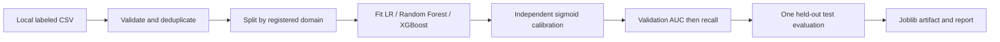

# PhishLens

Explainable URL and email phishing detection with CPU-only classical ML.
**Stages 1–6 implemented:** local data preparation, offline URL classification and SHAP,
plus calibrated TF-IDF/logistic email classification with exact term explanations.
URL/email models and an experimental online URL pilot are registered locally.
Stage 4 adds bounded, cached domain metadata and explicit offline fallback.
Stage 5 exposes predictions through FastAPI. Stage 6 adds a local Streamlit dashboard.



Python 3.11+ is required. From the repository root:

```sh
python -m venv .venv
# Windows PowerShell: .venv\Scripts\Activate.ps1
# Linux/macOS: source .venv/bin/activate
python -m pip install -e '.[dev]'
python -m pytest
python -m ruff check .
python -m phishlens.models.train_url --data data/urls.csv --output artifacts
python -m phishlens.models.prepare_email
python -m phishlens.models.train_email --data data/emails.csv --output artifacts
```

See [dataset instructions](data/README.md) before training. `make setup`,
`make train`, `make test` and `make lint` provide equivalent commands where GNU
Make is installed. Use direct Python commands on Windows if Make is unavailable.

Training writes `artifacts/url_offline.joblib`, a readable metadata JSON and
`url_report.md` with validation comparisons, selected model rationale, final test
metrics and confusion matrices. Only load trusted joblib files. No URL is visited.

The deterministic seed fixes splits and estimator randomness; versions and dataset
hash are stored in metadata. Exact reproducibility also requires identical input,
dependency versions and platform. Calibration uses domain-disjoint held-out data;
no scaling, model fitting or selection sees the test partition.

Open `notebooks/01_url_eda_and_models.ipynb` in your existing Jupyter environment for
EDA and Plotly comparisons. Notebook hosting is deliberately not a runtime dependency.
See [LEARNING](docs/LEARNING.md) and [MODEL_CARD](docs/MODEL_CARD.md).

## Run the dashboard (Stage 6)

Start the API as below, then open a second terminal in the repository root:

```sh
python -m streamlit run dashboard/app.py
# Or: make dashboard
```

Open `http://127.0.0.1:8501`. The reference-inspired navy dashboard has compact
URL/Email tabs, an input panel, a segmented circular risk meter, diverging feature
contributions, and the three strongest reasons. Email results show escaped,
highlighted cleaned text. There are no decorative headers, footers, fabricated
activity feeds or sample metrics. Narrow screens stack the panels.

The API status indicator and Refresh button check model availability. Analysis
buttons are disabled when their model is unavailable. Forms handle empty input,
loading, timeout, rate limits, validation errors and explicit offline fallback.
Results stay in the current Streamlit session until cleared or replaced; the UI
does not create a history database. Submitted email and URL content is sent to the
API, so keep it local or use a trusted HTTPS API. The optional environment variable
`PHISHLENS_API_URL` overrides `http://127.0.0.1:8000`; configure it in the dashboard
server's environment, not through an untrusted browser input.

The online pilot remains experimental. Its result panel says so, and fallback
results identify their offline model. A legitimate label is a model estimate,
not a guarantee that a link or email is safe.

## Run the API (Stage 5)

From the repository root, with trained artifacts present:

```sh
python -m uvicorn api.main:app --host 127.0.0.1 --port 8000 --no-access-log --no-proxy-headers
# Or: make api
```

Open `http://127.0.0.1:8000/docs` for interactive requests. Models load once
per server process through FastAPI's lifespan; explainers are reused lazily.
Inference runs in a worker thread and is serialized per process to bound memory.
Health checks remain responsive during inference. Use one worker for this local app:
each additional worker loads its own large forest and has independent rate limits.

| Endpoint | JSON request | Result |
| --- | --- | --- |
| `GET /health` | None | Status and each model's version, availability and experimental flag |
| `POST /predict/url` | `{"url":"https://example.com/about","mode":"offline"}` | Calibrated risk and URL feature contributions |
| `POST /predict/email` | `{"text":"Hello team, meeting tomorrow"}` | Calibrated risk, term contributions, cleaned text and highlights |

PowerShell example:

```powershell
Invoke-RestMethod http://127.0.0.1:8000/health
Invoke-RestMethod http://127.0.0.1:8000/predict/url -Method Post `
  -ContentType 'application/json' `
  -Body '{"url":"https://example.com/about","mode":"offline"}'
```

The URL request's `mode` defaults to `offline`; `online` performs only Stage 4's
bounded public-domain DNS/WHOIS operations. Incomplete lookups return
`mode: "offline_fallback"`, the offline version and an explicit `fallback_reason`.
Private/reserved online targets return 422. The currently installed online model
is an **experimental pilot**, exposed as such by health; its quality limitations
in [MODEL_CARD](docs/MODEL_CARD.md) still apply.

Prediction responses contain `risk_score`, `label`, `probability`, `mode`,
`model_version` and `top_features`. Each feature has `name`, `value`, `contribution`,
`direction` and `description`. Email highlights are half-open character offsets
in returned `cleaned_text`, not the original HTML. Contributions explain the
underlying model and are not risk-score points. A saved-model URL example:

```json
{"risk_score":29,"label":"legitimate","probability":0.288401822421012,
 "mode":"offline","model_version":"0.1.0"}
```

This abbreviated example omits feature/highlight fields. Actual values depend on
the trained artifact. URL input is limited to 8,192 characters, email to 100,000,
and encoded request bodies to 1,000,000 bytes, including chunked requests.
Unknown fields and malformed/invalid input return 422; oversized bodies return
413. Prediction requests share a 30-request/60-second fixed window per client IP
per process; 429 includes `Retry-After`. Health is exempt. The limiter keeps at
most 10,000 client entries and uses the direct socket peer, ignoring forwarded
headers; limits are for local use, not shared across server workers.

Missing offline artifacts produce health/prediction 503. Missing email artifacts
produce degraded health and email 503 while URL prediction stays available.
Missing online artifacts permit explicit offline fallback. Internal prediction
errors return a generic 500. Structured JSON logs record request IDs, route
templates, status and duration; they exclude bodies, URL inputs and query strings.
Keep Uvicorn access logging and proxy-header rewriting disabled as above so logs
exclude request query strings and client limits use the direct peer. Responses include
`X-Request-ID` and `Cache-Control: no-store`.

## Explain a URL (Stage 2)

After training with a real dataset:

```sh
python -m phishlens.explain.url_shap --url "https://example.com/about" --top-k 8
```

Or reuse one explainer in Python:

```python
from pathlib import Path
from phishlens.explain.url_shap import URLExplainer

explainer = URLExplainer.from_artifact(Path("artifacts/url_offline.joblib"))
result = explainer.explain("https://example.com/about")
for feature in result.top_features:
    print(feature["name"], feature["direction"], feature["contribution"])
```

Each feature includes its name, original value, signed contribution, risk direction
and description. Default: eight features, ranked by absolute contribution; use five
for a compact view. Zero contributions are marked `neutral`. Contributions always
refer to the phishing class, even when the overall prediction is legitimate.

The result also reports `base_value`, `explained_value`, `output_space`,
`calibration_orientation` and an explanation note. Contributions explain the fitted
base model: log-odds for logistic regression and XGBoost, uncalibrated probability
for random forest. They are not calibrated probability changes or risk-score points.
Only the full set of contributions, not a truncated top eight, adds to the baseline
to reconstruct the explained output. A decreasing calibration reverses signs and
prefixes `output_space` with `oriented_`; constant calibration yields zero influence.

Old Stage 1 artifacts remain supported when their feature schema matches. SHAP uses
training-derived baselines and never needs the dataset at explanation time.

The current URL model uses downloaded Kaggle Phishing Site URLs, replacing the
homepage-only PhiUSIIL baseline. Run `python -m phishlens.models.prepare_url` before
training. Random forest won validation ROC-AUC; held-out test precision is 87.81%,
positive recall 56.10%, F1 68.46%, and ROC-AUC 0.8973 at threshold 0.5. These lower
scores expose a harder task; they are not directly comparable to the old dataset's
near-perfect scores. Low recall means the model is not ready for automated blocking.

The original false alert on `https://example.com/about` fell from 99.98% to 28.84%
probability. All eight reserved benign-pattern probes are below the 35% suspicious
cutoff. Their five registered domains were excluded from fitting, calibration and
model selection. No whitelist, invented training paths or threshold change was used.
These probes diagnose the shortcut, not current page safety or production generalization.
Historical labels, scheme omission and source bias remain limitations.

The old model/input are preserved under `artifacts/phiusiil_baseline/`. Superseded PhiUSIIL CSVs were removed during cleanup;
source hashes remain in the baseline provenance. Run `python -m phishlens.models.audit_url` for the saved
candidate/baseline comparison; see [MODEL_CARD](docs/MODEL_CARD.md) for full metrics.

## Email model (Stage 3)

The six supplied source corpora are retained; the unused pre-cleaned aggregate
`phishing_email.csv` was deleted. [data/README.md](data/README.md) lists all files,
sources, label conventions and reproducible preparation steps.

Email preparation combines subject/body, excludes metadata, rejects unusable or
oversized messages, removes normalized duplicates and excludes conflicting labels.
`emails.csv` contains 76,826 documents. TF-IDF uses unigrams/bigrams and a 30,000-term
vocabulary fitted only on training documents. Logistic regression is calibrated
on separate documents; validation and test sets are also independent.

```python
from pathlib import Path
from phishlens.models.registry import load_artifact
from phishlens.explain.email_words import EmailExplainer

artifact = load_artifact(Path("artifacts/email.joblib"))
model = artifact["model"]
text = "Please verify your account password immediately."
probability = float(model.predict_proba([text])[0, 1])
explanation = EmailExplainer(model).explain(text)
print(probability, explanation.top_features)
```

Email inputs are limited to 100,000 characters. Cleaning strips HTML, excludes
script/style contents, normalizes URLs/email addresses and lowercases. Term
contributions are exactly coefficient times TF-IDF; calibrated risk direction is
reported separately from raw log-odds contributions. Both risk-raising and lowering
terms appear when available. Highlights use character offsets in `cleaned_text`,
not raw HTML. Overlapping highlights do not represent additional contributions.

The local email test scores are precision 98.04%, recall 98.24%, F1 98.14%, ROC-AUC
0.9985. **Positive labels include spam and fraud, not exclusively confirmed phishing.**
Document splits do not establish generalization across sources, campaigns, time or
languages. See `artifacts/email_report.md` and [MODEL_CARD](docs/MODEL_CARD.md).

## Online URL mode (Stage 4)

Online mode queries **only the public registered domain**, using DNS and registry
WHOIS over port 43. It never opens the URL, fetches HTML, follows redirects, follows
CNAMEs, queries URL subdomains, or connects to a returned mail/name server. Only
registry infrastructure name resolution is performed in addition to apex questions.
WHOIS referrals are ignored. IP literals, reserved/local names, private/nonpublic
apex addresses and multicast addresses are rejected. Offline mode remains pure
string analysis and may analyze private-address strings without contacting them.

Runtime cache: `data/online_cache.sqlite3`, keyed by ICANN registered domain, TTL
24 hours. A shared SQLite lease plus process gate allows one active lookup and a
two-second minimum interval between starts. DNS socket timeout: 1 second; WHOIS
socket budget: 3 seconds. A spawned worker is terminated at the 8-second total
lookup deadline, with bounded cleanup. Failed lookups are cached with exponential
backoff from 30 seconds up to one hour. Cache failure, busy/rate-limited collection,
missing WHOIS dates or other incomplete metadata returns `mode: offline_fallback`
using the existing offline model and a short `fallback_reason`. Unsafe targets
raise a validation error instead of becoming online predictions.

Collection and training are separate:

```sh
# Slow, resumable network acquisition: at most 100 sampled registered domains.
python -m phishlens.models.precompute_online --max-domains 100
# Pure local-file training; no DNS/WHOIS is performed here.
python -m phishlens.models.train_url_online
# URL CLI, including explanations and explicit fallback mode.
python -m phishlens.predict --url "https://python.org/about/" --mode online
```

Resume collection by rerunning it; completed cache records are retained. Increasing
`--max-domains` extends the deterministic sample. `--refresh` revisits completed
domains but still honors cache TTL and failure backoff. Keep the SQLite database:
the CSV is an atomic derived export, and collection can reconstruct it from the DB.
Training consumes `data/url_online_features.csv`, accepts complete successful rows
only, splits by the queried ICANN domain (including shared hosting tenants),
compares the same three estimators, calibrates separately and writes
`artifacts/url_online.joblib` plus metadata/report. It never collects missing rows.

`make collect-online` acquires the default bounded sample; `make train-online`
trains from its saved snapshot. `make train` trains all three models from local
files, requiring this snapshot first. `make train-offline` trains URL/email only.
All online limits and paths are in `config.py`/`OnlineSettings`. Python callers on
Windows should invoke live prediction from a guarded `if __name__ == "__main__"`
entry point or use the provided CLI, allowing spawn to import the worker safely.

**Pilot limitation:** the initial 100-domain collection produced 30 complete
snapshots, 69 failures and one nonpublic-address rejection. Those snapshots match
only 46 labeled URLs. The seven-row test set contains just one positive, which the
pilot misses at threshold 0.5 (precision/recall/F1 all zero). Its test AUC of 1.0
is not meaningful evidence of quality. The artifact version ends in `online-pilot`.
Do not use this pilot for operational decisions; collect and evaluate a much larger,
representative snapshot. Metadata from today's domains may not describe historical
URL labels. Missing metadata never becomes a zero-valued "safe" signal at inference.
